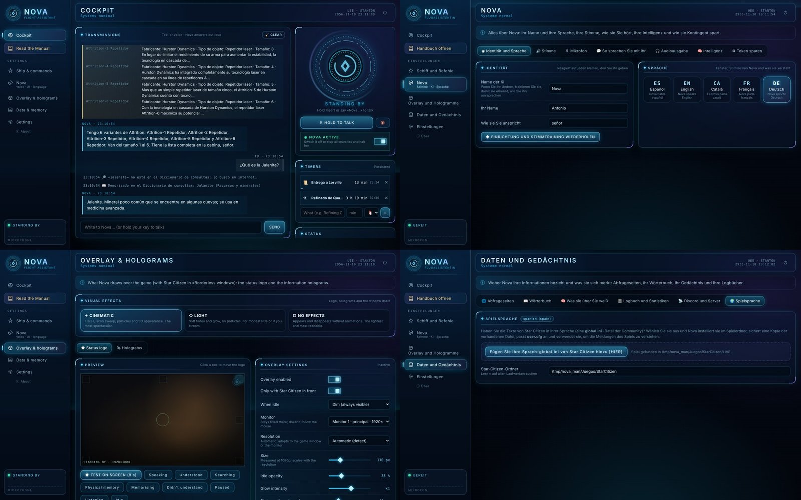
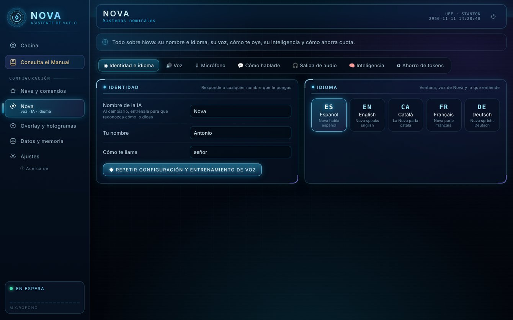
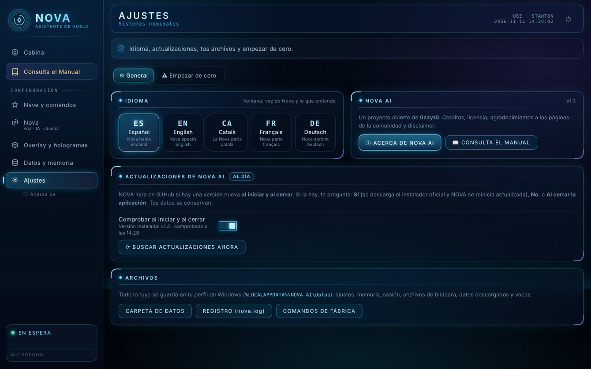
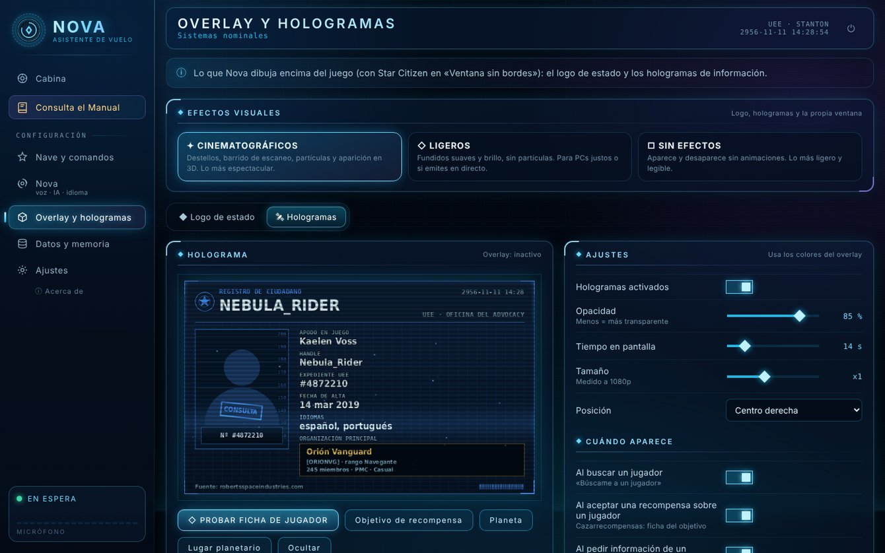
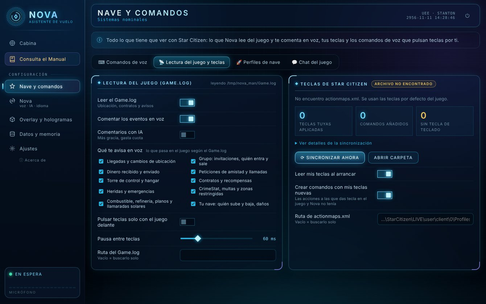
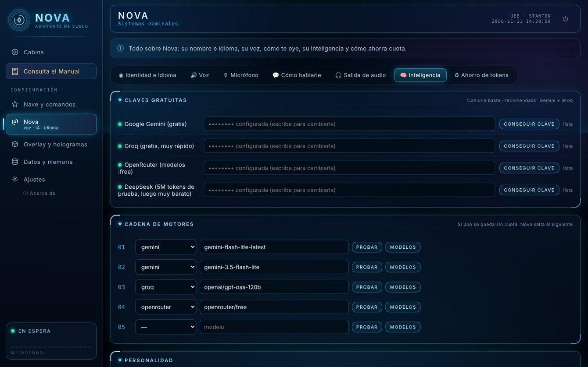
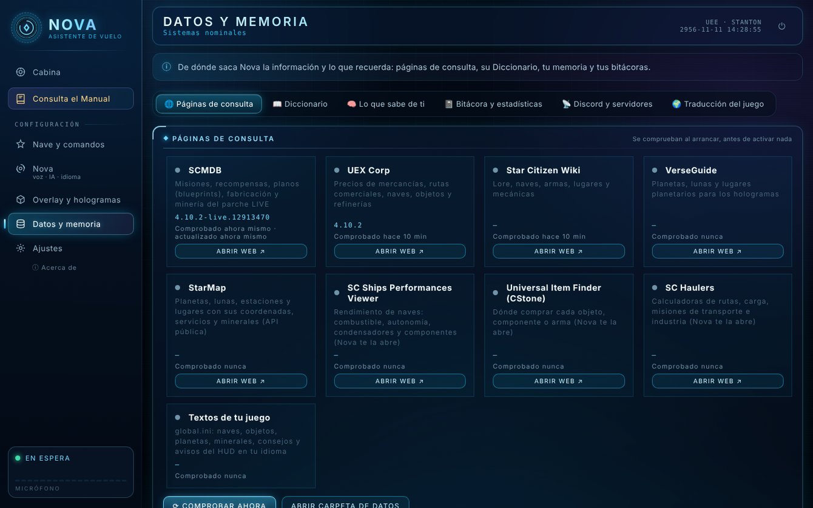
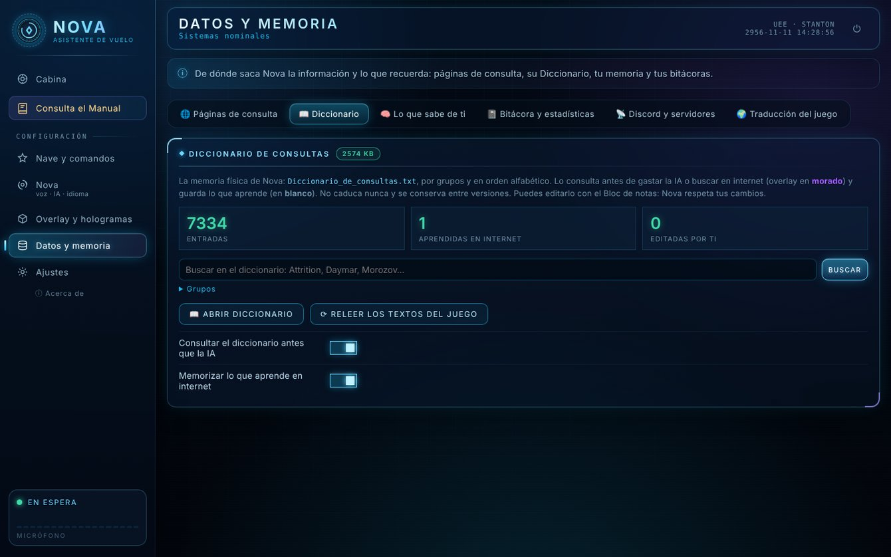

<p align="center">
  
</p>

<h1 align="center">NOVA AI</h1>
<p align="center"><b>Asistente de vuelo por voz para Star Citizen</b><br>
Te escucha, te responde con voz natural, pulsa las teclas del juego por ti y sabe qué está pasando en tu partida.<br>
<i>Versión oficial 1.3 · Windows 10/11 · español, English, català, français, Deutsch · todo gratis y de código abierto</i></p>

<p align="center">
  <a href="../../releases/latest"><b>⬇ Descargar NOVA AI Setup.exe</b></a> ·
  <a href="LEEME.md">Guía completa (LEEME)</a> ·
  <a href="../../releases/latest">Manual de usuario (PDF)</a> ·
  <a href="../../issues">Opiniones y errores</a> ·
  <a href="LICENSE">Licencia MIT</a> ·
  <a href="#code-signing-policy">Code signing policy</a> ·
  <a href="#in-english">English</a>
</p>


## Qué hace

- **Te escucha:** mantén una tecla, un botón del ratón o del HOTAS, o simplemente di su nombre: *«Nova, baja el tren»*. El nombre lo eliges tú.
- **Habla tu idioma:** español, inglés, catalán, francés o alemán. La ventana, su voz, lo que entiende, los comandos, los hologramas y el manual cambian con el idioma, y te trata siempre de usted.
- **Maneja la nave:** lee tus teclas de Star Citizen (`actionmaps.xml`) y las pulsa por ti: tren, pista, escudos, salto cuántico… Con un editor para crear tus propios comandos y secuencias.
- **Conversa y busca** (con tu clave gratuita de IA): lore, naves, minería, planos de fabricación, misiones y precios con datos del parche LIVE (scmdb.net, UEX Corp, Star Citizen Wiki, VerseGuide, StarMap…).
- **Te dice dónde comprar:** *«¿Dónde compro un P4-AR?»* y te contesta por voz con las tiendas y los precios, sin abrir el navegador.
- **Sigue tu partida:** lee el `Game.log` en directo: dónde estás, quién entra en tu nave, la torre, contratos, combate, curas en camilla médica, cargas…
- **Hologramas sobre el juego:** fichas de jugadores (con su organización), objetivos de recompensa, planetas, lunas y lugares, con efectos cinematográficos, ligeros o ninguno.
- **Chat del juego y Discord:** *«Nova, envía mensaje al chat…»* lo traduce y lo escribe por ti; las fichas pueden llegar solas a tu canal de Discord.
- **Recuerda:** un Diccionario de consultas con unas 7.000 entradas que contesta sin gastar IA, lo que le cuentas y un cuaderno de bitácora de cada sesión.
- **Star Citizen en tu idioma:** en español instala y mantiene al día la traducción de la comunidad (0zzyt0); en los demás idiomas instala el `global.ini` que elijas.
- **Brilla en el juego:** un overlay con su logo que cambia de color según lo que hace: escuchando, entendido, buscando o hablando.

## Novedades de la 1.3



- **Cinco idiomas**: español, English, català, français y Deutsch. Se eligen en el primer paso del instalador (propone el de tu Windows) o en *Ajustes › General*. Cambia la ventana, la voz de Nova (Edge y Piper), lo que entiende, los comandos de voz, los hologramas, la bitácora, las normas de uso y el manual. Quien ya usaba NOVA AI sigue en español.
- **«Add your Language global.ini of Star Citizen [HERE]»** (traducido a cada idioma), en *Datos y memoria › Traducción del juego*: instala el `global.ini` de la comunidad en tu idioma con copia de seguridad, ajusta `user.cfg` y Nova lo usa para entender el `Game.log`. Se deshace con un botón. En los idiomas distintos del español se desactivan la traducción de 0zzyt0 y su descarga de Google Drive.
- **Ventana nueva «Cristal holográfico»**, ordenada por tareas: **Cabina**, **Nave y comandos**, **Nova** (identidad e idioma, voz, micrófono, cómo hablarle, audio, inteligencia y ahorro de tokens), **Overlay y hologramas**, **Datos y memoria** y **Ajustes**. Cada sección tiene sus pestañas y una línea que explica para qué sirve.
- **Efectos en tres niveles** para el logo y los hologramas: **cinematográficos** (destellos, barrido y aberración cromática), **ligeros** (para equipos modestos o si emites en directo) o **sin efectos**.
- **«¿Dónde compro…?»** por voz con los datos de UEX Corp, sin abrir el navegador.
- **Comprobar las páginas de consulta** desde *Datos y memoria › Páginas de consulta*: Nova prueba cada página en línea y te dice cuáles responden.
- **Licencia MIT**: NOVA AI pasa a ser software libre y se compila desde este repositorio con GitHub Actions.

| | |
|---|---|
|  |  |
|  |  |

<details>
<summary><b>Novedades de versiones anteriores (1.2.2, 1.2 y 1.1)</b></summary>

### 1.2.2

- **Interruptor «NOVA ACTIVA»** en la Cabina: detiene a Nova al momento y cancela todas las búsquedas en curso.
- **Mensajes al chat del juego:** «Nova, envía mensaje al chat…» lo traduce con Google Translate y lo escribe en el chat (F12).
- **Discord:** cada ficha de jugador (y cada objetivo de recompensa) se manda sola, con foto y logotipo; la Cabina dice si llegó.
- **Sonidos de los hologramas a tu gusto:** varios para elegir o un audio tuyo, con volumen para cada uno.
- **Diccionario de consultas:** su memoria física en un .txt por grupos y en orden alfabético (unas 7.000 entradas del juego, con sus variantes). Contesta desde ahí sin gastar IA (overlay en morado) y memoriza lo que aprende en internet (en blanco). No caduca nunca.
- **Ahorro de tokens:** respuestas guardadas de datos fijos, planetas y lugares sin IA y traducciones gratis.
- **Más páginas de la comunidad:** StarMap (API pública), SPViewer, Universal Item Finder (CStone) y SC Haulers.
- **Manual dentro del programa** (📖 Consulta el Manual) con guía rápida y glosario, y Nova se presenta si le preguntas «¿quién eres?».

### 1.2: hologramas y actualizaciones

- **Se actualiza sola:** al iniciar y al cerrar mira las Releases de este repositorio y te pregunta si quieres actualizar ahora, más tarde o al cerrar.
- **Fichas en holograma sobre el juego**, con animación de proyector y opacidad, tamaño, posición y duración a tu gusto.
- **Ficha policial UEE** de un jugador: foto, datos y logotipo de su organización (los datos ocultos salen como `REDACTED`).
- **Cazarrecompensas:** al aceptar una recompensa sobre un jugador, ficha del objetivo con el sello «OBJETIVO DE CAZA».
- **Planetas, lunas y lugares planetarios** (cuevas, puestos, bases) de [verseguide.com](https://verseguide.com): al pedirlos por voz o al llegar cerca, con el cuerpo girando en 3D.

### 1.1

- **Buscar jugadores:** *«Nova, búscame a un jugador»* → escribes el apodo en la Cabina y te da su ficha pública de RSI. Se guarda en la bitácora y, si quieres, se manda a Discord.
- **Temporizadores** persistentes para refinados, contratos o lo que quieras, con aviso por voz.
- **Rutas de comercio** con el beneficio real según las SCU de tu nave, el stock, la demanda y tu dinero (UEX).
- **Perfiles de nave:** avisos distintos por nave y comandos que solo valen en ciertas naves.
- **Estado de los servidores de RSI** al arrancar.
- **Fijar objetivo por voz** anotado en la bitácora, **estadísticas** de todas tus sesiones y botón **🧹 Limpiar** en la Cabina.

</details>

## Capturas

| | |
|---|---|
| <br><sub>**Nave y comandos:** tus comandos de voz y sus teclas</sub> | <br><sub>**Lectura del juego:** qué avisos lee del Game.log</sub> |
| <br><sub>**Nova › Inteligencia:** claves gratuitas y cadena de motores</sub> | <br><sub>**Datos y memoria:** páginas de consulta y su comprobación</sub> |
| <br><sub>**Diccionario de consultas:** contesta sin gastar IA</sub> | <br><sub>**Bitácora y estadísticas** de tus sesiones</sub> |

## Instalación

1. Descarga **`NOVA AI Setup.exe`** desde [Releases](../../releases/latest) (o el `.zip` portátil).
2. Ábrelo y acepta el permiso de administrador (se instala en `C:\Program Files\NOVA AI`).
3. **Elige tu idioma** (propone el de tu Windows).
4. Acepta las Normas de uso y la Política de privacidad, en tu idioma ([ES](NORMAS_Y_PRIVACIDAD.md) · [EN](NORMAS_Y_PRIVACIDAD.en.md) · [CA](NORMAS_Y_PRIVACIDAD.ca.md) · [FR](NORMAS_Y_PRIVACIDAD.fr.md) · [DE](NORMAS_Y_PRIVACIDAD.de.md)), y pulsa **Iniciar**.
5. Al terminar, abre **NOVA AI** desde el escritorio: un asistente de 7 pasos la deja lista para tu voz.

El instalador descarga Python 3.12 si no lo tienes (solo para Nova), crea los accesos directos y registra el desinstalador. Todos los detalles están en el [LEEME](LEEME.md) y en el manual en PDF de *Releases*.

> [!IMPORTANT]
> **Los ejecutables de la 1.3 todavía no están firmados.** La firma digital gratuita está solicitada a SignPath Foundation (ver [Code signing policy](#code-signing-policy)).
>
> - **«Windows protegió su PC» (SmartScreen):** pulsa *Más información → Ejecutar de todas formas*.
> - **Control inteligente de aplicaciones** (Windows 11, *Seguridad de Windows › Control de aplicaciones y navegador*): si está en **Activado**, bloquea cualquier programa sin firmar y no permite excepciones. Para instalar NOVA AI hay que ponerlo en **Desactivado** (el `.zip` portátil también se bloquea) o esperar a la versión firmada. Desde la actualización de Windows de abril de 2026 se puede volver a activar después sin reinstalar Windows. Si está en **Evaluación**, Windows decide solo y puede dejarlo pasar.
>
> Para comprobar que el archivo es el original, compara la huella SHA-256 que muestra GitHub junto a cada archivo de la Release con la de tu descarga: `certutil -hashfile "NOVA AI Setup.exe" SHA256`.

<p align="center"></p>

## Motores de IA y claves

NOVA AI usa servicios gratuitos, en una **cadena de motores**: si uno se queda sin cuota, salta al siguiente.

| # | Proveedor | Modelo |
|---|---|---|
| 1 | Google Gemini | `gemini-flash-lite-latest` |
| 2 | Google Gemini | `gemini-3.5-flash-lite` |
| 3 | Groq | `openai/gpt-oss-120b` |
| 4 | OpenRouter | `openrouter/free` |

El instalador de *Releases* **no trae claves de IA**: Nova obedece los comandos de voz desde el primer momento, y para conversar y buscar necesita al menos una clave gratuita. Se consiguen en 2 minutos y sin tarjeta (Gemini y Groq son las recomendadas): el capítulo 11 del manual, *Tus propias API Keys*, lo explica paso a paso. Después se pegan en ***Nova › Inteligencia › Claves gratuitas***. Nova contesta siempre en el idioma que hayas elegido.

**Sobre las claves en este repositorio:** el programa admite claves de fábrica **cifradas** (`recursos/claves_iniciales.enc`, ver [`core/keyvault.py`](core/keyvault.py)), pero la llave maestra **no está en el repositorio ni en la versión pública**, así que esas claves no se pueden usar ni leer. Si compilas tu propia versión, usa tus claves con [`build/cifrar_claves.py`](build/cifrar_claves.py), o no pongas ninguna y cada usuario pondrá las suyas.

## Opiniones, errores e ideas

¿Lo has probado? Cuéntalo en **[Issues](../../issues)**: qué te ha gustado, qué falla y qué echas en falta. Para un error ayuda mucho indicar el idioma elegido, la versión de Windows, qué le dijiste a Nova y el archivo `nova.log` (*Ajustes › General › Archivos › Registro*). Se aceptan opiniones en cualquiera de los cinco idiomas.

## Ejecutar desde el código

```bat
git clone https://github.com/0zzyt0/NOVA-AI.git
cd NOVA-AI
INSTALAR_CONSOLA.bat   :: crea el entorno .venv e instala lo necesario (modo portátil)
INICIAR.bat
```

Requisitos: Windows 10/11 y Python 3.11–3.13. Para ver los mensajes técnicos, usa `DEPURAR.bat`.

## Compilar el instalador

Los ejecutables (`NOVA AI Setup.exe`, `NOVA AI.exe`, `Desinstalar NOVA AI.exe`) son programas pequeños en Go, solo con su biblioteca estándar. El icono, el manifiesto y la información de versión se generan con [`build/winres.py`](build/winres.py), sin herramientas externas.

```bash
build/build_win.sh                    # todo de una vez (Go 1.24+ y Python 3); el resultado queda en dist/
NOVA_STAGE=exes build/build_win.sh    # 1.º solo los .exe del programa y el instalador ligero
NOVA_STAGE=pack build/build_win.sh    # 2.º empaqueta esos .exe (ya firmados) en el instalador todo en uno
```

Las versiones públicas se compilan con **GitHub Actions** ([`.github/workflows/compilar.yml`](.github/workflows/compilar.yml), «Compilar y firmar») en los servidores de GitHub, al publicar una etiqueta `v*` o a mano: compila los .exe, los manda a firmar, empaqueta el instalador, lo manda a firmar y deja como artefacto el `Setup.exe`, el `.zip` portátil y `SHA256SUMS.txt`. La firma solo se activa cuando el proyecto tiene configurado SignPath; sin ella el flujo produce la misma versión sin firmar. Más detalles en [`build/LEEME_COMPILAR.md`](build/LEEME_COMPILAR.md).

## Estructura

| Carpeta | Contenido |
|---|---|
| `nova.py` | Arranque: idioma inicial, datos nuevos, el oído, la voz y la ventana |
| `core/` | Reconocimiento y síntesis de voz, IA, comandos y teclas, lectura del Game.log, hologramas, overlay, bitácora, memoria, fuentes de datos, traducción e idiomas (`i18n.py`, `lang_data.py`, `manual_tr.py`) |
| `gui/` | Ventana local (HTML + JS) y servidor; `gui/web/manual/` es el manual y `gui/web/acerca/` la ventana «Acerca de» |
| `instalador/` | Instalador y desinstalador gráficos en cinco idiomas (PowerShell + WPF) |
| `build/` | Fuentes de los .exe (Go), generador de recursos de Windows e iconos |
| `.github/workflows/` | Compilación y firma con GitHub Actions |
| `recursos/idiomas/` | Textos de la ventana y de Nova en inglés, catalán, francés y alemán |
| `datos/comandos.json` | Comandos de voz de fábrica (español) y `datos/comandos.<idioma>.json` con sus frases en cada idioma |
| `NORMAS_Y_PRIVACIDAD*.md` | Normas de uso y Política de privacidad en los cinco idiomas |

## Privacidad

Tus datos se quedan en tu PC (`%LOCALAPPDATA%\NOVA AI\datos`): sin servidores propios, sin cuentas y sin telemetría, y no se hacen grabaciones. Lo que le pides a Nova se envía como texto al servicio de IA que responde, como si lo escribieras en su web; los textos que no están ya traducidos se traducen con Google Translate. El detalle completo está en las [Normas de uso y Política de privacidad](NORMAS_Y_PRIVACIDAD.md).

## Acerca de

<p align="center"></p>

**NOVA AI · Versión oficial 1.3**, de **Aaron B. Roldan** (gametag de Star Citizen: **0zzyt0**). Desarrollado con el motor de IA **Claude Opus 5.5** (Anthropic).

**Agradecimientos** a la **Org. Defcorp**, y gracias a: Faibo, Galleg0, Sr.Scott, AlpacaInTrouble, Lother… ¡y muchos más!

## Licencia

NOVA AI es **software libre bajo la [licencia MIT](LICENSE)**: puedes usarlo, modificarlo y compartirlo, también dentro de otros proyectos, siempre que conserves el aviso de copyright y la licencia. Resumen en español y derechos de terceros en [LICENCIA.txt](LICENCIA.txt).

## Code signing policy

Free code signing provided by [SignPath.io](https://about.signpath.io), certificate by [SignPath Foundation](https://signpath.org).

*Firma de código gratuita de SignPath.io, con certificado de SignPath Foundation.* Los ejecutables de Windows (`NOVA AI Setup.exe`, `NOVA AI.exe` y `Desinstalar NOVA AI.exe`) se compilan desde este repositorio con GitHub Actions y se firman solo después de que el aprobador revise y autorice cada versión.

**Team roles / Roles del equipo**

- Committers and reviewers / Autores y revisores: [Aaron B. Roldan (@0zzyt0)](https://github.com/0zzyt0)
- Approvers / Aprobadores: [Aaron B. Roldan (@0zzyt0)](https://github.com/0zzyt0)

**Privacy policy / Política de privacidad**

This program will not transfer any information to other networked systems unless specifically requested by the user or the person installing or operating it. What each online feature sends, and how to turn it off, is described in the privacy policy shown during installation: [English](NORMAS_Y_PRIVACIDAD.en.md) · [Español](NORMAS_Y_PRIVACIDAD.md) · [Català](NORMAS_Y_PRIVACIDAD.ca.md) · [Français](NORMAS_Y_PRIVACIDAD.fr.md) · [Deutsch](NORMAS_Y_PRIVACIDAD.de.md).

## In English

**NOVA AI** is a free, open-source (MIT) voice flight assistant for Star Citizen on Windows 10/11. It listens (push-to-talk or its name), answers with a natural voice, presses your game keybinds for you, reads `Game.log` live, shows holograms over the game (player records, bounty targets, planets and places) and keeps a logbook of every session.

Version 1.3 speaks **English, Spanish, Catalan, French and German**: choose the language in the installer or in *Settings › General*. Outside Spanish, *Data & memory › Game language* has an **«Add your Language global.ini of Star Citizen [HERE]»** button that installs your community translation (with a backup and `user.cfg`). Ask *«Where can I buy a P4-AR?»* and Nova answers by voice from UEX data, without opening a browser.

To chat and search, Nova needs at least one free AI key (Gemini or Groq, no card needed), pasted in *Nova › Intelligence › Free keys*. The 1.3 executables are **not code-signed yet** (a SignPath Foundation application is in progress): SmartScreen needs *More info → Run anyway*, and Windows 11 **Smart App Control**, when set to *On*, blocks unsigned apps with no exceptions. Feedback and bug reports are welcome in **[Issues](../../issues)**.

## Derechos de terceros

Star Citizen®, Squadron 42®, Roberts Space Industries® y Cloud Imperium® son marcas registradas de Cloud Imperium Rights LLC. Todas las referencias a Star Citizen que aparecen en NOVA AI (logotipos, nombres de naves, personajes, objetos, lugares y demás contenidos del juego) pertenecen a sus legítimos titulares y están sujetas a sus propios derechos de uso. NOVA AI es un proyecto de fans, independiente y sin ánimo de lucro: no está afiliado, patrocinado ni respaldado por Cloud Imperium Games.

Las páginas de consulta [scmdb.net](https://scmdb.net), [UEX Corp](https://uexcorp.space), [Star Citizen Wiki](https://starcitizen.tools), [VerseGuide](https://verseguide.com), StarMap, SPViewer, [Universal Item Finder (CStone)](https://finder.cstone.space) y SC Haulers, así como el sitio de [Roberts Space Industries](https://robertsspaceindustries.com), son propiedad de sus respectivos autores, tienen sus propias condiciones de uso y sus contenidos están protegidos. NOVA AI se limita a **consultarlas en línea y a leer la información que publican**, igual que lo haría cualquier persona desde su navegador: **no modifica, altera ni manipula sus datos, no los redistribuye** (los datos de scmdb.net, con licencia CC BY-NC-ND 4.0, no se incluyen en este repositorio: se descargan en cada equipo) **y no se atribuye su autoría**. Lo mismo se aplica a Google Translate, a los `global.ini` de las comunidades de traducción y a la traducción al español de 0zzyt0.

<p align="center"><b>o7 · Nos vemos en el 'verso</b></p>
