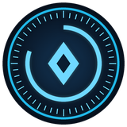
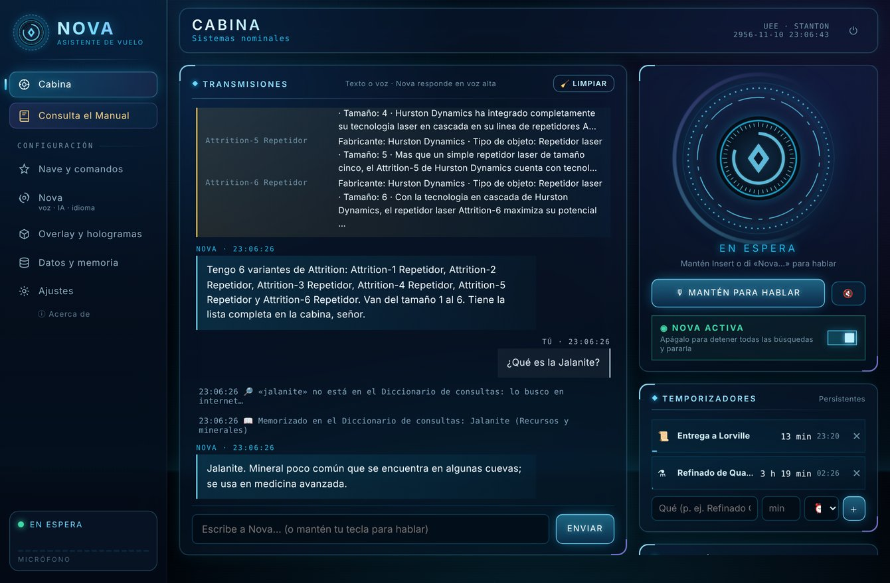
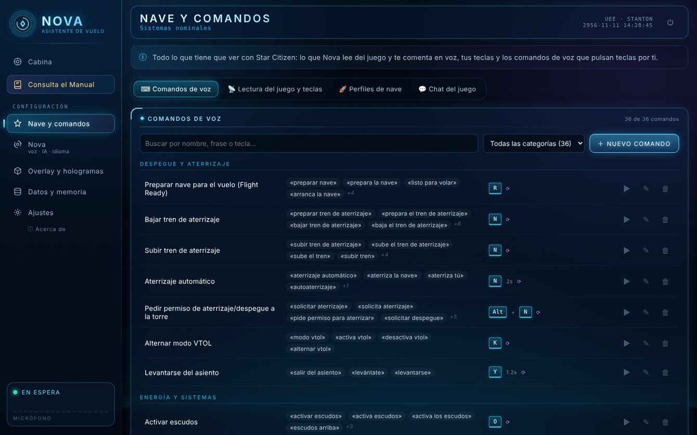
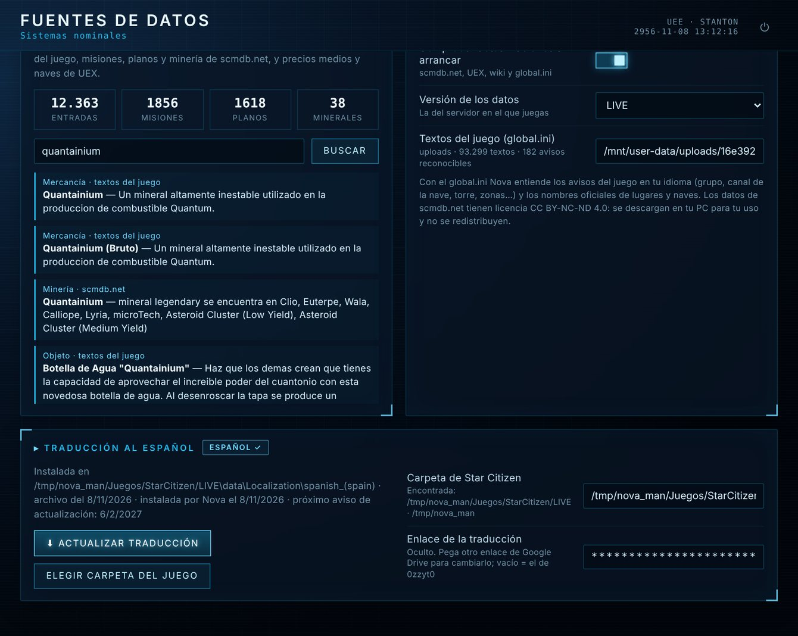
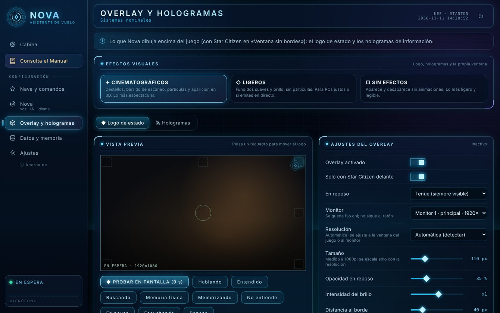
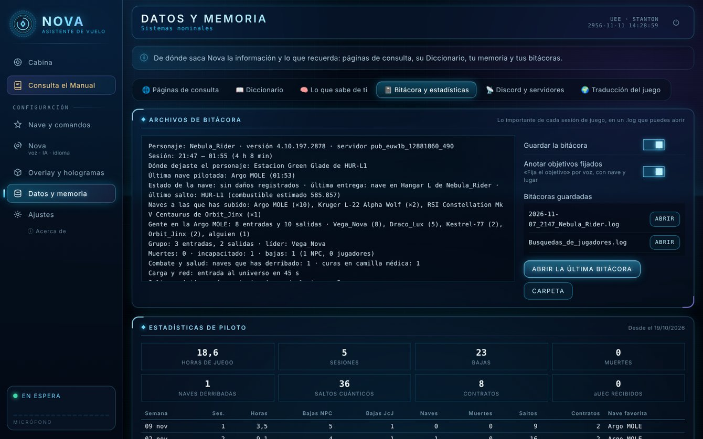
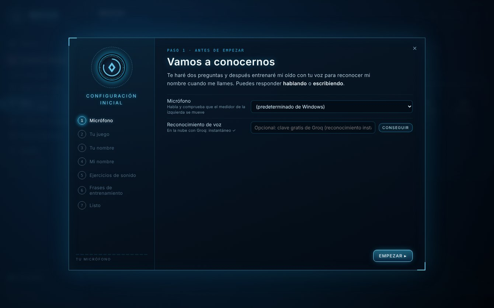
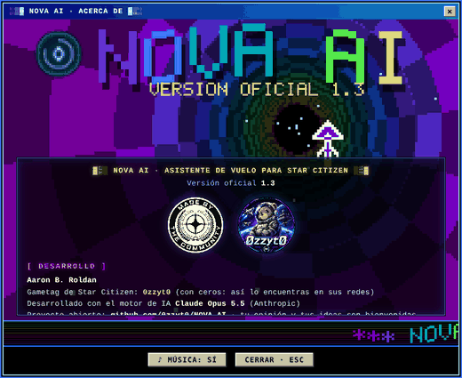

<p align="center">
  
</p>

<h1 align="center">NOVA AI</h1>
<p align="center"><b>Asistente de vuelo por voz para Star Citizen</b><br>
Te escucha, te responde con voz natural, pulsa las teclas del juego por ti y sabe qué está pasando en tu partida.<br>
<i>Versión oficial 1.2 · Windows 10/11 · en español · todo gratis</i></p>

<p align="center">
  <a href="../../releases/latest"><b>⬇ Descargar NOVA AI Setup.exe</b></a> ·
  <a href="LEEME.md">Guía completa (LEEME)</a> ·
  <a href="../../releases/latest">Manual de usuario (PDF)</a> ·
  <a href="LICENCIA.txt">Licencia</a>
</p>



## Qué hace

- **Te escucha:** mantén una tecla, un botón del ratón o del HOTAS, o simplemente di su nombre: *«Nova, baja el tren»*. El nombre lo eliges tú.
- **Maneja la nave:** lee tus teclas de Star Citizen (`actionmaps.xml`) y las pulsa por ti: tren, pista, escudos, salto cuántico… Con un editor para crear tus propios comandos y secuencias.
- **Conversa y busca** (con tu clave gratuita de IA): lore, naves, minería, planos de fabricación, misiones y precios, con datos del parche LIVE (scmdb.net, UEX Corp, Star Citizen Wiki) y una enciclopedia local.
- **Sigue tu partida:** lee el `Game.log` en directo, en el idioma de tu juego: dónde estás, quién entra en tu nave, la torre, contratos, combate, curas en camilla médica, cargas…
- **Cuaderno de bitácora:** apunta cada sesión: dónde dejaste el personaje, la última nave, muertes, bajas, incapacitaciones…
- **Star Citizen en español:** instala y mantiene al día la traducción de la comunidad (0zzyt0) con un clic, y te avisa cada 3 meses.
- **Brilla en el juego:** un overlay con su logo que cambia de color: escuchando, entendido, buscando o hablando.
- **Recuerda:** lo que le cuentas, la conversación y dónde lo dejaste, aunque cierres el programa.

### Novedades de la 1.2: hologramas y actualizaciones

- **Se actualiza sola:** al iniciar y al cerrar mira las Releases de este repositorio y pregunta «Se ha detectado una nueva versión vX.X de NOVA AI. ¿Quieres actualizar ahora?» [Sí] [No] [Al cerrar la aplicación].

- **Fichas en holograma sobre el juego**, con animación de proyector y opacidad, tamaño, posición y duración a tu gusto.
- **Ficha policial UEE** de un jugador: foto, datos y logotipo de su organización (los datos ocultos salen como `REDACTED`).
- **Cazarrecompensas:** al aceptar una recompensa sobre un jugador, ficha del objetivo con el sello «OBJETIVO DE CAZA».
- **Planetas, lunas y lugares planetarios** (cuevas, puestos, bases) de [verseguide.com](https://verseguide.com): al pedirlos por voz o al llegar cerca, con el cuerpo girando en 3D.

### Novedades de la 1.1

- **Buscar jugadores:** *«Nova, búscame a un jugador»* → escribes el apodo en la Cabina y te da su ficha pública de RSI (apodo, handle, UEE Citizen Record, fecha de alta, idiomas, organización principal y datos de la org). Se guarda en la bitácora y, opcionalmente, se manda a un canal de Discord (webhook).
- **Temporizadores** persistentes para refinados, contratos o lo que quieras, con aviso por voz.
- **Rutas de comercio** con el beneficio real según las SCU de tu nave, el stock, la demanda y tu dinero (UEX).
- **Perfiles de nave:** avisos distintos por nave y comandos que solo valen en ciertas naves.
- **Estado de los servidores de RSI** al arrancar.
- **Fijar objetivo por voz** anotado en la bitácora, **estadísticas** de todas tus sesiones y botón **🧹 Limpiar** en la Cabina.

| | |
|---|---|
|  |  |
|  |  |

## Instalación

1. Descarga **`NOVA AI Setup.exe`** desde [Releases](../../releases/latest).
2. Ábrelo y acepta el permiso de administrador (se instala en `C:\Program Files\NOVA AI`).
3. Acepta las [Normas de uso y la Política de privacidad](NORMAS_Y_PRIVACIDAD.md) y pulsa **Iniciar**.
4. Al terminar, abre **NOVA AI** desde el escritorio: un asistente de 7 pasos la deja lista para tu voz.

> **«Windows protegió su PC»:** el instalador no está firmado con un certificado de pago. Pulsa *Más información → Ejecutar de todas formas*.

El instalador descarga Python 3.12 si no lo tienes (solo para Nova), crea los accesos directos y registra el desinstalador. Todos los detalles están en el [LEEME](LEEME.md) y en el manual en PDF de la sección *Releases*.

<p align="center"></p>

## Motores de IA y claves

NOVA AI usa servicios gratuitos, en una **cadena de motores**: si uno se queda sin cuota, salta al siguiente.

| # | Proveedor | Modelo |
|---|---|---|
| 1 | Google Gemini | `gemini-flash-lite-latest` |
| 2 | Google Gemini | `gemini-3.5-flash-lite` |
| 3 | Groq | `openai/gpt-oss-120b` |
| 4 | OpenRouter | `openrouter/free` |

El instalador de *Releases* **no trae claves de IA**: Nova obedece los comandos de voz desde el primer momento, y para conversar y buscar necesita al menos una clave gratuita. Se consiguen en 2 minutos y sin tarjeta (Gemini y Groq son las recomendadas): la sección 12 del manual lo explica paso a paso. Después se pegan en *Inteligencia › Claves gratuitas*.

**Sobre las claves en este repositorio:** el programa admite claves de fábrica **cifradas** (`recursos/claves_iniciales.enc`, ver [`core/keyvault.py`](core/keyvault.py)), pero la llave maestra **no está en el repositorio ni en la versión pública**, así que esas claves no se pueden usar ni leer. Si compilas tu propia versión, usa tus claves con [`build/cifrar_claves.py`](build/cifrar_claves.py), o no pongas ninguna y cada usuario pondrá las suyas.

## Ejecutar desde el código

```bat
git clone https://github.com/<usuario>/NOVA-AI.git
cd NOVA-AI
INSTALAR_CONSOLA.bat   :: crea el entorno .venv e instala lo necesario (modo portátil)
INICIAR.bat
```

Requisitos: Windows 10/11 y Python 3.11–3.13. Para ver los mensajes técnicos, usa `DEPURAR.bat`.

## Compilar el instalador

Los ejecutables (`NOVA AI Setup.exe`, `NOVA AI.exe`, `Desinstalar NOVA AI.exe`) son programas pequeños en Go, solo con su biblioteca estándar. El icono, el manifiesto y la información de versión se generan con [`build/winres.py`](build/winres.py), sin herramientas externas.

```bash
build/build_win.sh      # necesita Go 1.24+ y Python 3; el resultado queda en dist/
```

## Estructura

| Carpeta | Contenido |
|---|---|
| `nova.py` | Arranque: comprueba datos nuevos, activa el oído, la voz y la ventana |
| `core/` | Reconocimiento y síntesis de voz, IA, comandos y teclas, lectura del Game.log, bitácora, memoria, fuentes de datos, traducción |
| `gui/` | Ventana local (HTML + JS) y servidor; `gui/web/acerca/` es la ventana «Acerca de» |
| `instalador/` | Instalador y desinstalador gráficos (PowerShell + WPF) |
| `build/` | Fuentes de los .exe (Go), generador de recursos de Windows e iconos |
| `datos/comandos.json` | Comandos de voz de fábrica |

## Privacidad

Tus datos se quedan en tu PC (`%LOCALAPPDATA%\NOVA AI\datos`): sin servidores propios, sin cuentas y sin telemetría, y no se hacen grabaciones. Lo que le pides a Nova se envía como texto al servicio de IA que responde, como si lo escribieras en su web. El detalle completo está en [NORMAS_Y_PRIVACIDAD.md](NORMAS_Y_PRIVACIDAD.md).

## Acerca de

<p align="center"></p>

**NOVA AI · Versión oficial 1.2**, de **Aaron B. Roldan** (gametag de Star Citizen: **0zzyt0**). Desarrollado con el motor de IA **Claude Opus 5.5** (Anthropic).

**Agradecimientos** a la **Org. Defcorp**, y gracias a: Faibo, Galleg0, Sr.Scott, AlpacaInTrouble, Lother… ¡y muchos más!

## Licencia

**Libre uso y modificación.** Si usas este proyecto o lo modificas, por favor menciona de dónde has sacado las ideas y cuál es tu base. Por ejemplo: *«Basado en NOVA AI, de Aaron B. Roldan (0zzyt0)»*. Texto completo en [LICENCIA.txt](LICENCIA.txt).

## Derechos de terceros

Star Citizen®, Squadron 42®, Roberts Space Industries® y Cloud Imperium® son marcas registradas de Cloud Imperium Rights LLC. Todas las referencias a Star Citizen que aparecen en NOVA AI (logotipos, nombres de naves, personajes, objetos, lugares y demás contenidos del juego) pertenecen a sus legítimos titulares y están sujetas a sus propios derechos de uso. NOVA AI es un proyecto de fans, independiente y sin ánimo de lucro: no está afiliado, patrocinado ni respaldado por Cloud Imperium Games.

Las páginas de consulta [scmdb.net](https://scmdb.net) y [UEX Corp](https://uexcorp.space) son propiedad de sus respectivos autores, tienen sus propias condiciones de uso y sus contenidos están protegidos. NOVA AI se limita a **consultarlas en línea y a leer la información que publican**, igual que lo haría cualquier persona desde su navegador: **no modifica, altera ni manipula sus datos, no los redistribuye** (los datos de scmdb.net, con licencia CC BY-NC-ND 4.0, no se incluyen en este repositorio: se descargan en cada equipo) **y no se atribuye su autoría**. Lo mismo se aplica a Star Citizen Wiki y a la traducción al español de la comunidad.

<p align="center"><b>o7 · Nos vemos en el 'verso</b></p>
