<p align="center">
  
</p>

<h1 align="center">NOVA AI</h1>
<p align="center"><b>Voice flight assistant for Star Citizen</b> · English · <a href="README.es.md">Español</a><br>
She listens, answers with a natural voice, presses your game keys for you and knows what's happening in your game.<br>
<i>Official version 2.0 · Windows 10/11 · English, español, català, français, Deutsch · completely free and open source</i></p>

<p align="center">
  <a href="../../releases/latest"><b>⬇ Download NOVA AI Setup.exe</b></a> ·
  <a href="#accessibility-play-with-your-voice">Accessibility</a> ·
  <a href="../../issues">Feedback &amp; bugs</a> ·
  <a href="LICENSE">MIT License</a> ·
  <a href="#code-signing-policy">Code signing policy</a> ·
  <a href="README.es.md">Español</a>
</p>

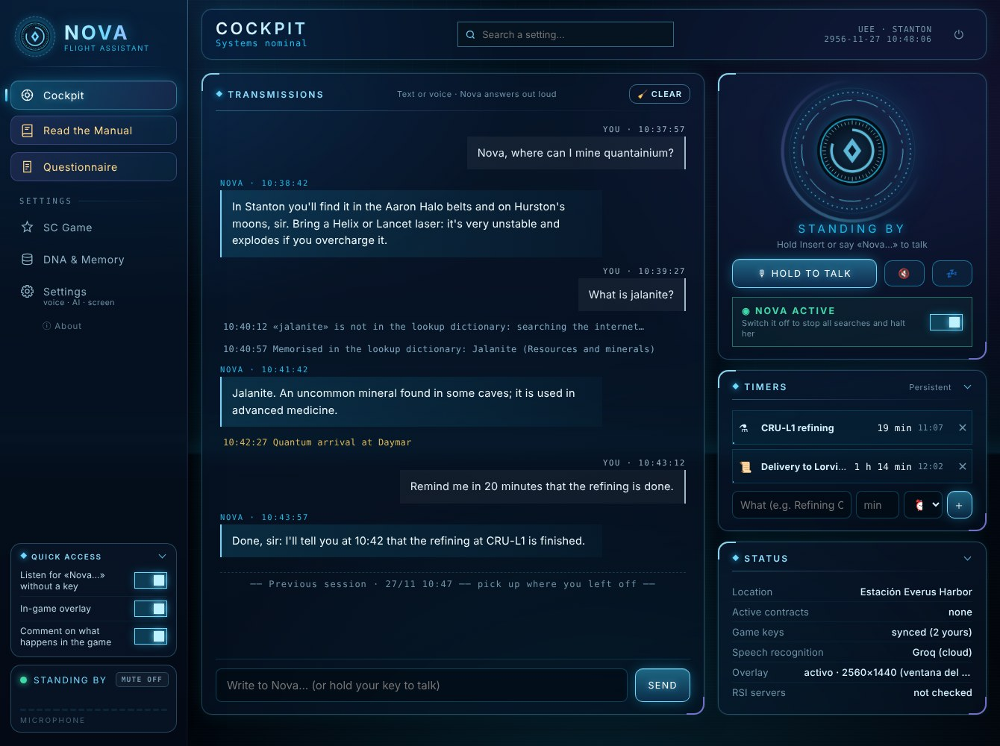

## What it does

- **She listens:** hold a key, a mouse button or a HOTAS button, or just say her name: *"Nova, lower the landing gear"*. You choose her name.
- **She speaks your language:** English, Spanish, Catalan, French or German. The window, her voice, what she understands, the commands, the holograms and the manual all follow the language you pick, and she always addresses you politely.
- **She flies the ship with you:** she reads your Star Citizen keybinds (`actionmaps.xml`) and presses them for you: landing gear, ATC, shields, quantum, VTOL… A command editor lets you create your own commands and key sequences.
- **She talks and looks things up** (with a free AI key): lore, ships, mining, crafting blueprints, missions and prices with LIVE patch data (scmdb.net, UEX Corp, Star Citizen Wiki, VerseGuide, StarMap…).
- **She tells you where to buy things:** *"Where can I buy a P4-AR?"* and she answers by voice with the shops and prices, without opening a browser.
- **She follows your game:** she reads `Game.log` live: where you are, who boards your ship, ATC, contracts, combat, med-bed healing, cargo…
- **Holograms over the game:** citizen records (with their org), bounty targets, planets, moons and places, with cinematic, light or no effects.
- **Game chat and Discord:** *"Nova, send a message to chat…"* and she translates it and types it for you; player cards can be posted to your Discord channel when you say "yes".
- **She remembers:** a lookup dictionary with about 7,000 entries that answers without spending AI quota, the things you tell her, and a logbook of every session.
- **Star Citizen in your language:** install the community `global.ini` translation you choose (Spanish players also get the 0zzyt0 community translation, kept up to date).
- **She glows in the game:** an overlay with her logo changes colour with what she's doing: listening, understood, searching or speaking.

## Accessibility: play with your voice

Star Citizen asks for a lot of hands: stick, throttle, mouse, keyboard shortcuts, key combinations you have to hold, and typing in chat. NOVA AI moves much of that to your voice, so it can make a real difference for players with a **physical disability or limited mobility**: a missing hand, fingers or arm, reduced grip or dexterity, tremor, repetitive strain injury… and for anyone flying with one hand on the stick.

- **Nothing to press:** say her name (*"Nova, …"*) and she listens, no key needed. Or use any key, mouse button or HOTAS button to talk, including a USB foot pedal that sends a key.
- **Your controls, by voice:** landing gear, landing and takeoff requests, VTOL, shields, power, weapons, lights, quantum, cruise control, decoupled mode, flares and chaff, next target… Nova reads your own keybinds (`actionmaps.xml`), so there are no shortcuts to memorise and no combinations to press.
- **No more awkward combos:** in the command editor one phrase can hold a key down or press several keys in a row. *"Takeoff sequence"* and *"landing sequence"* come built in, and you can create your own. To respect the RSI Terms of Service on macros, the cautious key mode (on by default) keeps each command to what you could do with one press: keys held for 3 s at most, no chained waits and no mouse clicks inside sequences.
- **Type without a keyboard:** *"Nova, send a message to chat: need a medic at Lorville"* and she types it in the game chat for you, translated if you want.
- **Information without letting go of the controls:** ask about ships, weapons, mining, missions or where to buy something and she answers out loud, without leaving the game or opening a browser. Important game events are announced by voice and as holograms too.
- **Timers by voice** (with an AI key): *"remind me about the refinery in 3 hours"*.
- **She adapts to the way you speak:** the setup wizard trains her name with your voice, and you can tune the microphone sensitivity and how long she waits in silence before your sentence is over.

For example, with one hand on the stick: *"Nova, flight ready"*, *"request takeoff"*, *"raise landing gear"* and, in combat, *"flares"* or *"next attacker"*, without ever letting go. Flying and aiming still need a stick, mouse or controller; Nova takes care of almost everything else. If you use NOVA AI for accessibility and something is missing, please tell us in [Issues](../../issues): it's a priority.

## What's new in 2.0

- **Reorganised window:** **SC Game** (voice commands, keys and joystick, game alerts with ship profiles, chat and game language), **Nova** (identity, voice, listening, intelligence), **Screen** (overlay, holograms and appearance), **Information** (sources and servers, dictionary, what she knows about you, logbook, Discord) and **Settings** (the only place to change the language, window and tray, updates, backups and starting over). A **settings search** in the header (or `Ctrl+F`) takes you straight to any option.
- **Voice styles:** seven ready-tuned styles with the feel of film onboard AIs (onboard butler, ship computer, friendly copilot, tactical AI…). They are synthetic Microsoft Edge voices and **don't imitate any actor or character**.
- **Voice effects:** a much stronger *cockpit AI* filter plus *helmet comms*, *radio* and *walkie-talkie* (static, squelch and an "over" beep), with adjustable strength.
- **Game names pronounced in English** in Spanish, Catalan, French and German (*Crusader*, *Hurston*, *Cutlass*…), with your own editable pronunciation list.
- **Colour themes** for the window, **new overlay logos** (or your own PNG), **4 hologram styles**, **4 ways to appear** and **thicker lettering** that reads better over the game.
- **Backups:** export and import your settings, commands, memory, dictionary and logbook to a `.novacopia` file. **AI keys are never included.**
- **First start:** the setup wizard shows where it found your **Game.log** and lets you pick it.
- **Installer:** choose the **folder and drive** (with the free space shown), a lighter download (WebP manual images) and an unattended mode, tested on Windows with GitHub Actions.
- **Alerts:** the armistice zone is announced only once when entering and once when leaving; *Test on screen* lasts 15 s; the overlay preview shows a game scene.
- **Mistral** became paid in August 2026: it's no longer in the default engine chain, but you can still add your own key.

### Make it yours

**Seven colour themes** (*Screen › Appearance*). Status colours (green, yellow, red, purple) never change, so they keep their meaning:

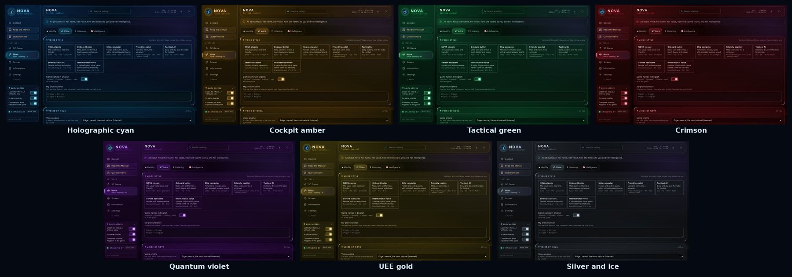

| | |
|---|---|
| 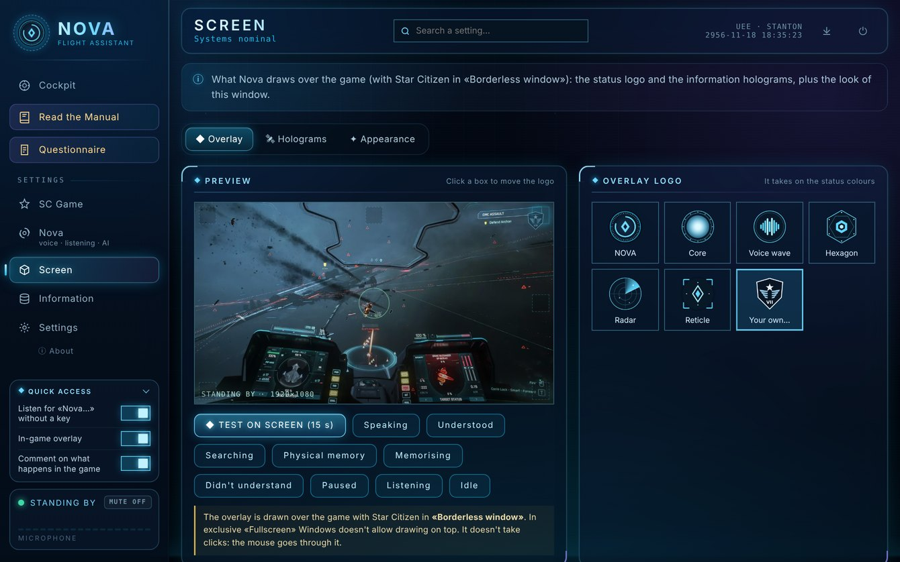<br><sub>**Overlay logo:** six built-in designs or **your own PNG** (here a squadron badge), tinted with the status colours over a game scene</sub> | 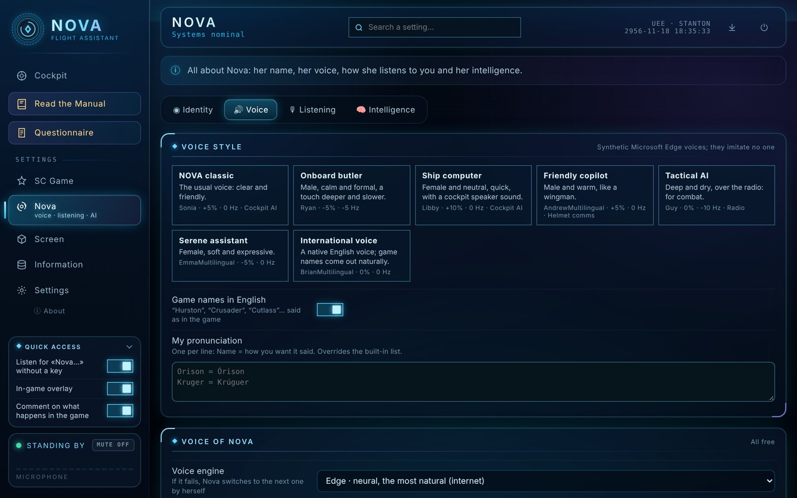<br><sub>**Voice styles** with the feel of film onboard AIs, and game names said in English</sub> |

**Voice effects:** cockpit AI, helmet comms, radio and walkie-talkie, each with its own strength.

<p align="center">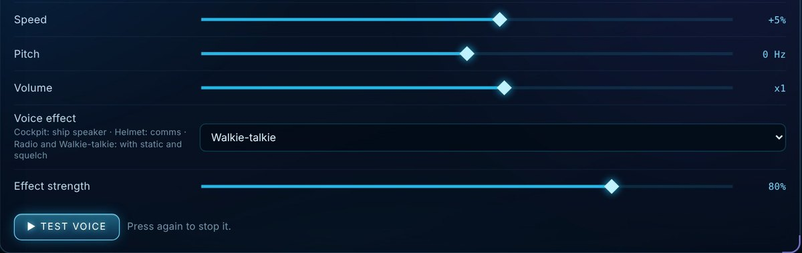</p>

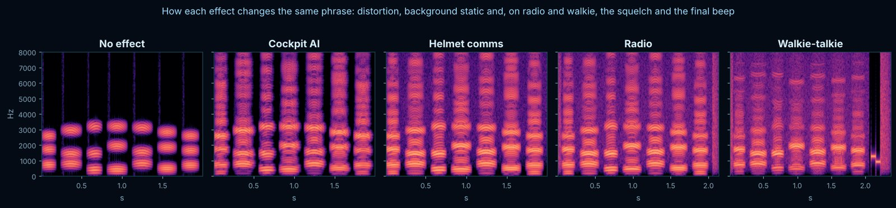

**New holograms:** four card styles (Classic, Bevelled, Glass, Tactical), four ways to appear and thicker lettering.

| | |
|---|---|
| 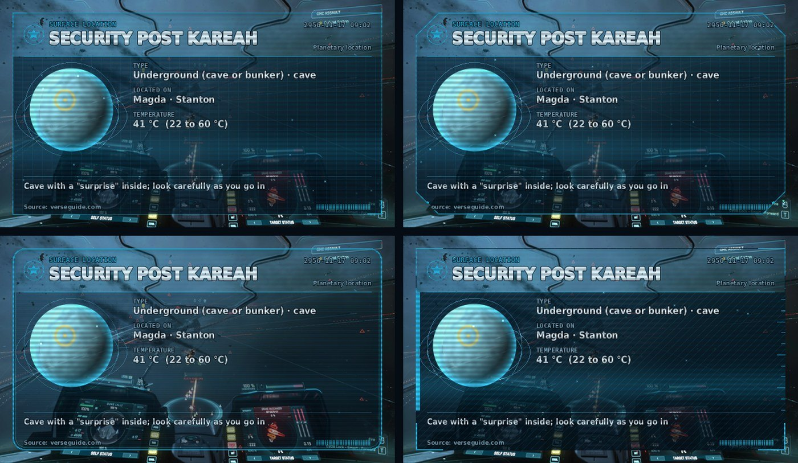<br><sub>**Card styles** over the game</sub> | 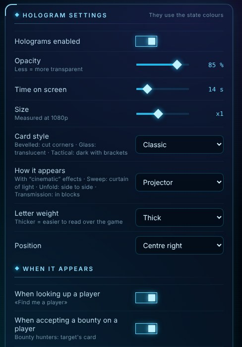<br><sub>**Screen › Holograms:** card style, how it appears and letter weight</sub> |

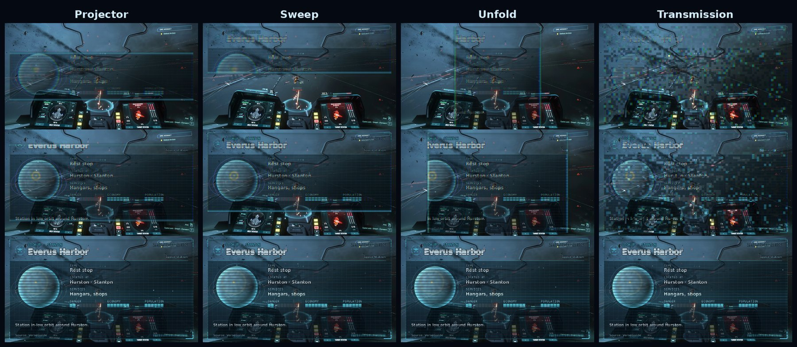
<sub>From top to bottom: the hologram appearing and fully shown with each entrance effect.</sub>

## What's new in 1.5

- **Shop purchases in the logbook:** Nova reads what you buy from `Game.log` (with the item name in your language) and adds it to the logbook and the session summary; *Pilot statistics* add up the aUEC you spend in shops. A failed purchase is announced.
- **What you equip** (armour, weapons, MedPens) is grouped into one logbook line, and Nova tells you when **your** ship's docking tube is ready.
- **Finer Game.log reading:** quantum jumps following a party member's marker, party invitations and joins, and quantum errors only when they're yours.
- **The manual in five languages:** the PDF and the in-app manual now come in English, Spanish, Catalan, French and German, each with its own screenshots.
- **Fixes:** the 1.4 uninstaller didn't open (install 1.5 over it to get the fixed one); the installer subtitle follows your language; in English, Catalan, French and German the chat player card, hologram data and several window texts no longer appear in Spanish, and naming the AI works with natural phrases.

## What's new in 1.4.1

- **The anonymous questionnaire is live:** the *Questionnaire* button now appears in the sidebar, below *Read the Manual*.

## What's new in 1.4

- **Keeps running in the Windows tray:** close the window and Nova stays next to the clock, still listening, with the overlay in the game and timers running. Click the icon to open her; right-click for MUTE, sleep mode or *Exit NOVA AI*. You can turn this off in *Settings › General › Window & tray*.
- **Sleep mode** (*Nova › Microphone*): after the minutes you choose without talking to her (or never, the default), Nova rests and the overlay dims. Wake her with your talk key, the ☀ button or by typing, or choose to wake her by name. You can also say *"Nova, sleep mode"* or use the 💤 button in the Cockpit.
- **Guided tour:** after the setup wizard (or the first time you open 1.4), Nova shows you where every option is in one minute. Repeat it from *Settings › General*.
- **Anonymous questionnaire:** rate NOVA AI from 1 to 10 and share your ideas. It is published as a public issue here, without your name, gametag or computer data. Nova reminds you once after 3 days and never insists.

**Microphone, fair play and AI engines:**

- **A sturdier microphone:** Nova tries your microphone through several Windows audio paths (MME, DirectSound, WASAPI) and at its native rate (e.g. 48 kHz). If it can't open it, she falls back to the Windows default microphone and tells you. *Nova › Microphone* shows which device is really open and warns you when it only hears total silence (a headset muted with its own button, or blocked in Windows privacy) or a very weak signal.
- **Microphone gain** (×1 to ×8) in *Nova › Microphone*; the setup wizard raises it for you if your voice comes in too quiet.
- **MUTE button** on the microphone meter (left sidebar): **MUTE ON** (green) and Nova hears nothing, neither the push-to-talk key nor her name.
- **Cautious key mode** (*Ship & commands › Game reading & keys*, on by default): a voice command never does more than you could do with one press: no long chained waits, no mouse clicks inside sequences, keys held for 3 s at most and never looped, in line with the RSI Terms of Service on macros.
- **RSI lookups and Discord posts only when you say "yes":** bounty targets are no longer looked up automatically, and player cards are no longer posted to Discord on their own. Player cards are cached for 10 minutes and RSI requests are spaced at least 2 s apart.
- **Mistral replaces DeepSeek** as a free AI engine (Experiment plan, no credit card). DeepSeek still works if you already had its key.
- **Edge no longer offers to save your API keys** as passwords.
- Translation fixes (overlay status, sample holograms, the "YOU" chat label) and GitHub Actions updated.

## What's new in 1.3.1

- **Cockpit without scrollbars:** the right column adapts to your screen; if it doesn't fit, *Status* and *Timers* fold away with a summary ("2 active"). Click their header to open or fold them.
- **Quick access moved to the left sidebar**, above the microphone meter.
- **New About window:** new music and a faster, wilder animation that follows the beat, now translated too.

## What's new in 1.3

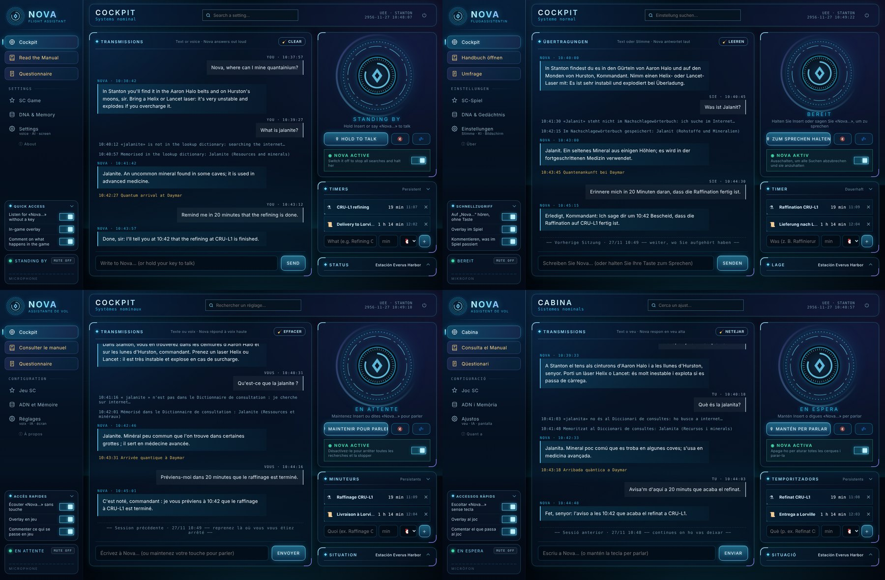

- **Five languages**: English, español, català, français and Deutsch. Choose one in the first step of the installer (it suggests your Windows language) or in *Settings › General*. It changes the window, Nova's voice (Edge and Piper), what she understands, the voice commands, the holograms, the logbook, the terms of use and the manual. Existing users stay in Spanish.
- **"Add your Language global.ini of Star Citizen [HERE]"** (translated into each language) in *Data & memory › Game language*: it installs the community `global.ini` for your language with a backup, sets `user.cfg`, and Nova uses it to understand `Game.log`. One click undoes it. In languages other than Spanish, the 0zzyt0 Spanish translation and its Google Drive download are turned off.
- **New "holographic glass" window**, organised by task: **Cockpit**, **Ship & commands**, **Nova** (identity & language, voice, microphone, how to talk to her, audio output, intelligence and token saving), **Overlay & holograms**, **Data & memory** and **Settings**. Each section has its own tabs and a line explaining what it's for.
- **Three effect levels** for the logo and the holograms: **cinematic** (sparks, sweep and chromatic aberration), **light** (for modest PCs or streaming) or **no effects**.
- **"Where can I buy…?"** by voice with UEX Corp data, without opening a browser.
- **Check the lookup pages** from *Data & memory › Lookup pages*: Nova tests every page online and tells you which ones answer.
- **MIT License**: NOVA AI is now free software and is built from this repository with GitHub Actions.

| | |
|---|---|
| 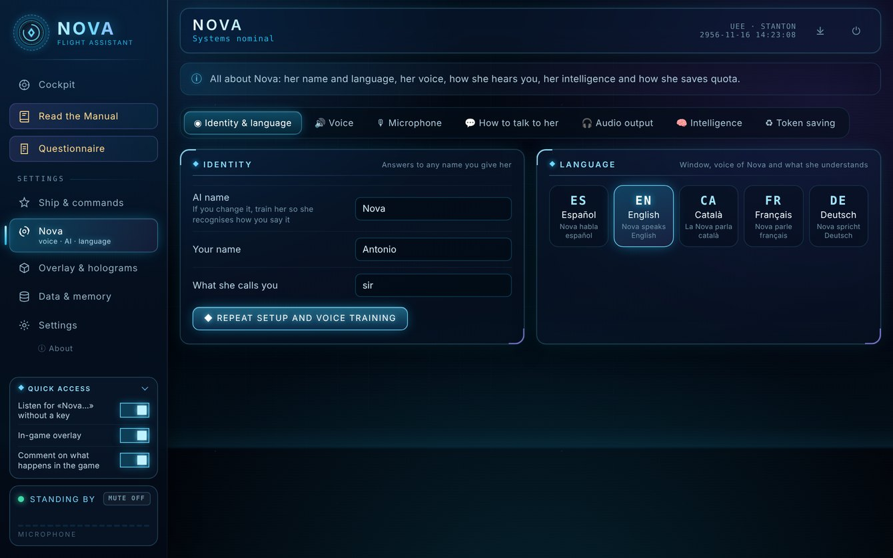 | 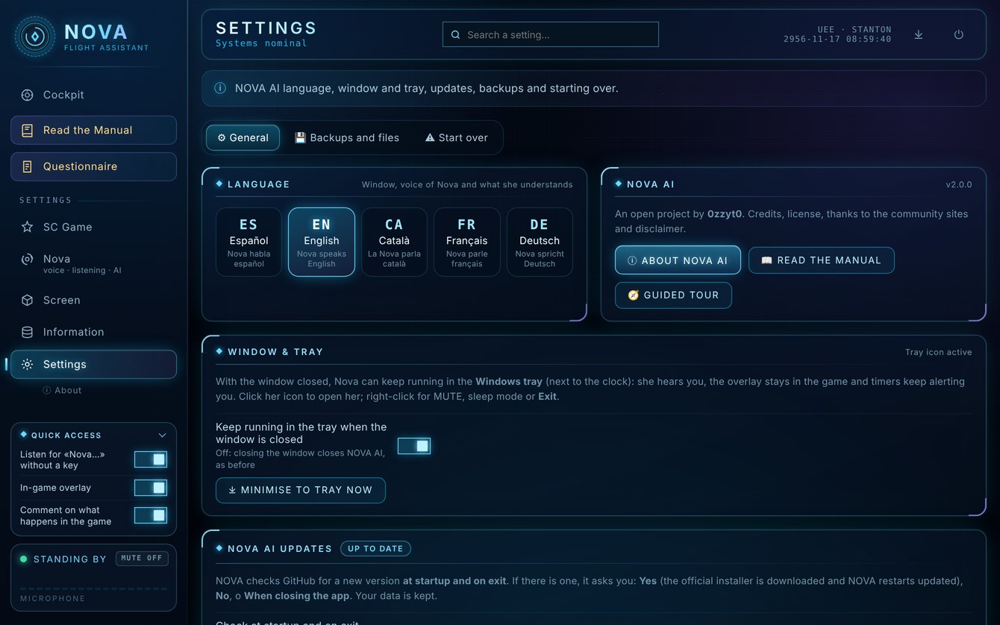 |
| 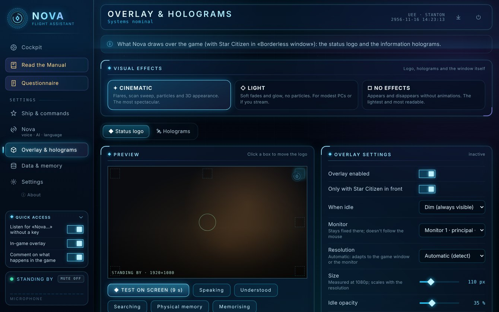 | 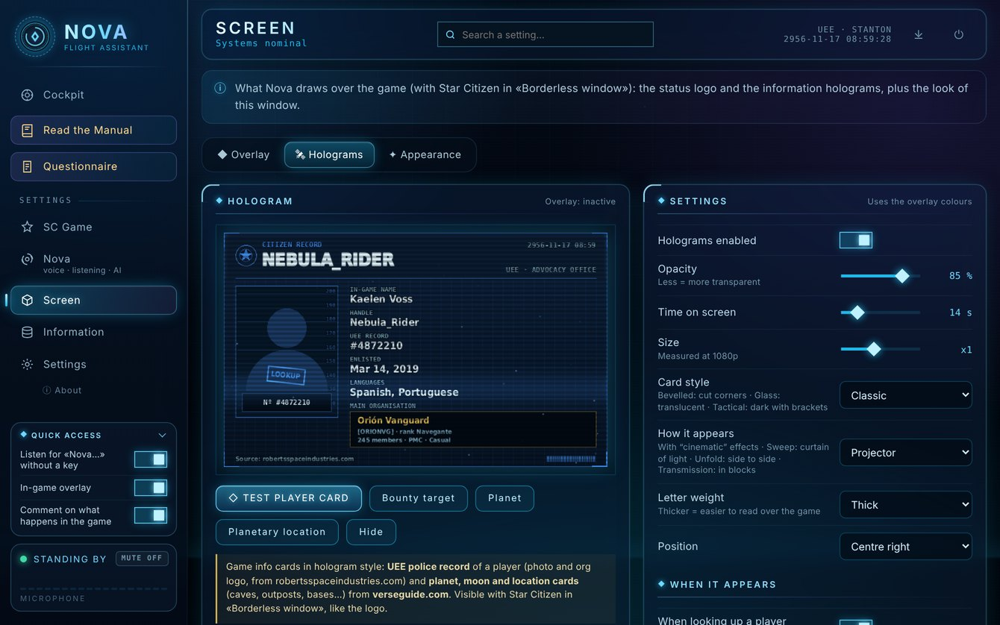 |

<details>
<summary><b>Earlier versions (1.2.2, 1.2 and 1.1)</b></summary>

### 1.2.2

- **"NOVA ACTIVE" switch** in the Cockpit: stops Nova at once and cancels every search in progress.
- **Messages to the game chat:** "Nova, send a message to chat…" translates it with Google Translate and types it in the chat (F12).
- **Discord:** every player card (and every bounty target) is posted automatically, with photo and org logo; the Cockpit shows whether it arrived.
- **Hologram sounds your way:** several to choose from or your own audio, with a volume for each.
- **Lookup dictionary:** Nova's physical memory in a .txt file, by group and in alphabetical order (about 7,000 game entries, with their variants). She answers from it without spending AI quota (purple overlay) and memorises what she learns online (white). It never expires.
- **Token saving:** saved answers for fixed data, planets and places without AI, and free translations.
- **More community pages:** StarMap (public API), SPViewer, Universal Item Finder (CStone) and SC Haulers.
- **Manual inside the app** (📖 Read the Manual) with a quick guide and glossary, and Nova introduces herself if you ask "who are you?".

### 1.2: holograms and updates

- **Updates itself:** on start and on exit it checks this repository's Releases and asks whether to update now, later or on exit.
- **Info cards as holograms over the game**, with a projector animation and your choice of opacity, size, position and duration.
- **UEE police record** of a player: photo, details and org logo (hidden data shows as `REDACTED`).
- **Bounty hunters:** when you accept a bounty on a player, a card of the target with the "BOUNTY TARGET" stamp.
- **Planets, moons and planetary locations** (caves, outposts, bases) from [verseguide.com](https://verseguide.com): when you ask by voice or fly nearby, with the body rotating in 3D.

### 1.1

- **Player lookup:** *"Nova, look up a player"* → type the handle in the Cockpit and she shows their public RSI record. It's saved in the logbook and, if you want, posted to Discord.
- **Persistent timers** for refining, contracts or anything else, with a voice reminder.
- **Trade routes** with the real profit for your ship's SCU, stock, demand and budget (UEX).
- **Ship profiles:** different announcements per ship, and commands that only work in certain ships.
- **RSI server status** on start.
- **Pin a target by voice**, noted in the logbook, **statistics** for all your sessions and a **🧹 Clear** button in the Cockpit.

</details>

## Screenshots

| | |
|---|---|
| 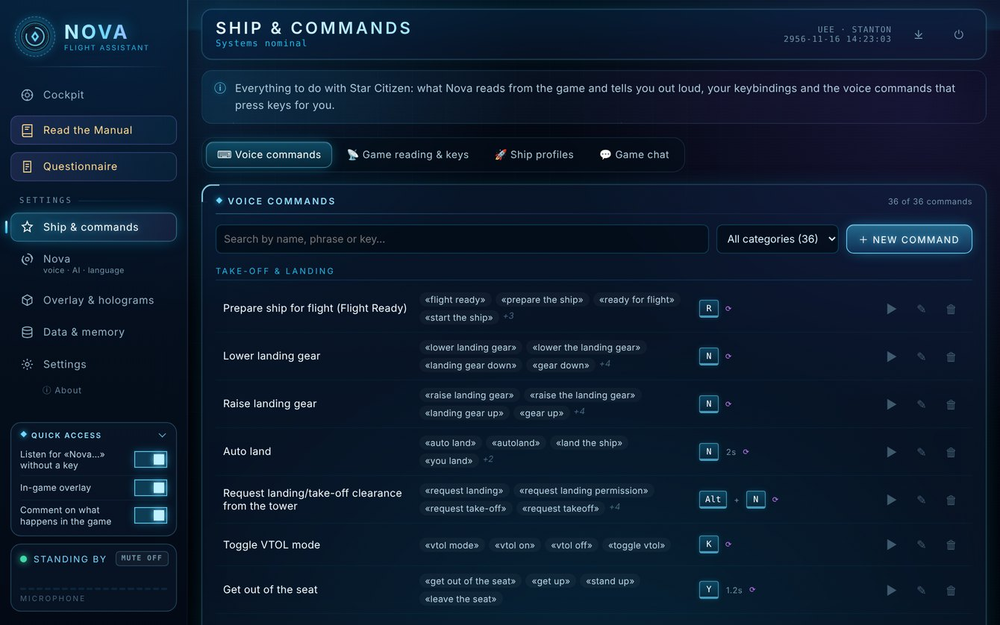<br><sub>**SC Game:** your voice commands and their keys</sub> | 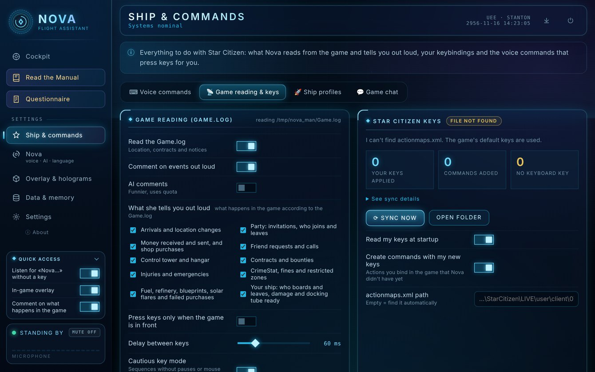<br><sub>**Keys and joystick:** your Star Citizen keys and how Nova presses them</sub> |
| 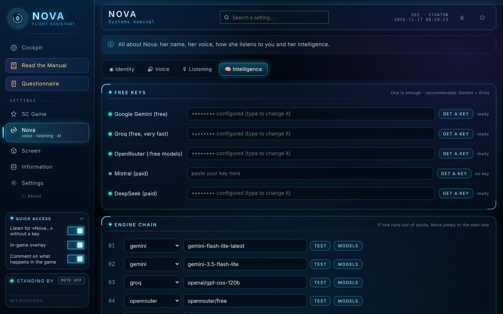<br><sub>**Nova › Intelligence:** free keys and engine chain</sub> | 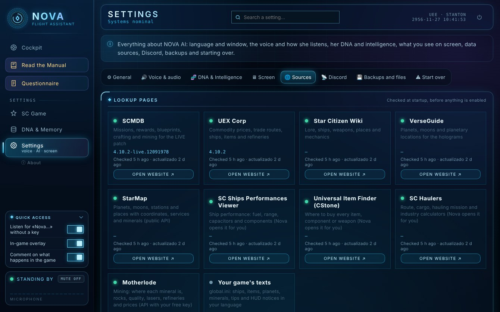<br><sub>**Information › Sources:** lookup pages and their check</sub> |
| 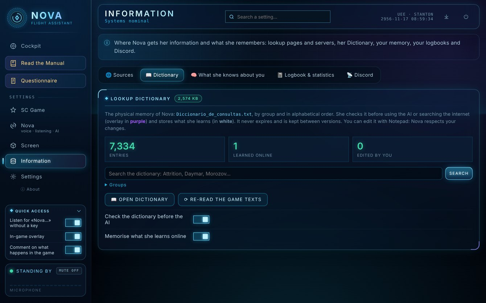<br><sub>**Lookup dictionary:** answers without spending AI</sub> | 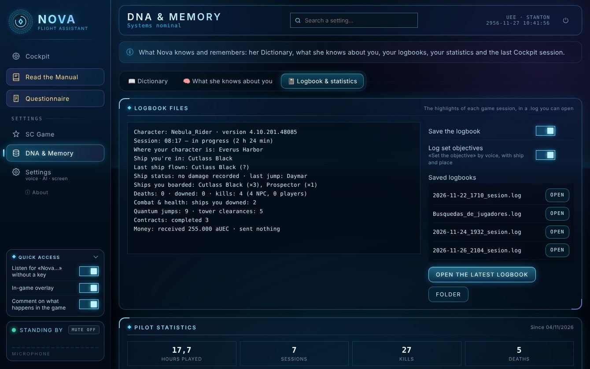<br><sub>**Logbook & statistics** of your sessions</sub> |

<sub>Every screen is also available in Spanish, Catalan, French and German (*Settings › General › Language*).</sub>

## Installation

1. Download **`NOVA AI Setup.exe`** from [Releases](../../releases/latest) (or the portable `.zip`).
2. Open it and accept the administrator prompt (it installs to `C:\Program Files\NOVA AI` by default; **Choose folder…** lets you pick another folder or drive).
3. **Choose your language** (it suggests your Windows language).
4. Accept the Terms of use and Privacy policy, in your language ([EN](NORMAS_Y_PRIVACIDAD.en.md) · [ES](NORMAS_Y_PRIVACIDAD.md) · [CA](NORMAS_Y_PRIVACIDAD.ca.md) · [FR](NORMAS_Y_PRIVACIDAD.fr.md) · [DE](NORMAS_Y_PRIVACIDAD.de.md)), and click **Start**.
5. When it finishes, open **NOVA AI** from the desktop: a 7-step wizard tunes her to your voice.

The installer downloads Python 3.12 if you don't have it (for Nova only), creates the shortcuts and registers the uninstaller. The in-app manual (*Read the Manual*) and the PDF manual in *Releases* come in all five languages, with screenshots of the window in each one; the detailed technical guide ([LEEME](LEEME.md)) is in Spanish.

> [!IMPORTANT]
> **The 2.0 executables are not code-signed yet.** A free code signing certificate has been requested from SignPath Foundation (see [Code signing policy](#code-signing-policy)).
>
> - **"Windows protected your PC" (SmartScreen):** click *More info → Run anyway*.
> - **Smart App Control** (Windows 11, *Windows Security › App & browser control*): when it is **On**, it blocks any unsigned program and allows no exceptions. To install NOVA AI you have to set it to **Off** (the portable `.zip` is blocked too) or wait for the signed version. Since the April 2026 Windows update it can be turned back on later without reinstalling Windows. In **Evaluation** mode Windows decides by itself and may let it through.
>
> To check that the file is the original, compare the SHA-256 shown by GitHub next to each Release file with your download: `certutil -hashfile "NOVA AI Setup.exe" SHA256`.

<p align="center">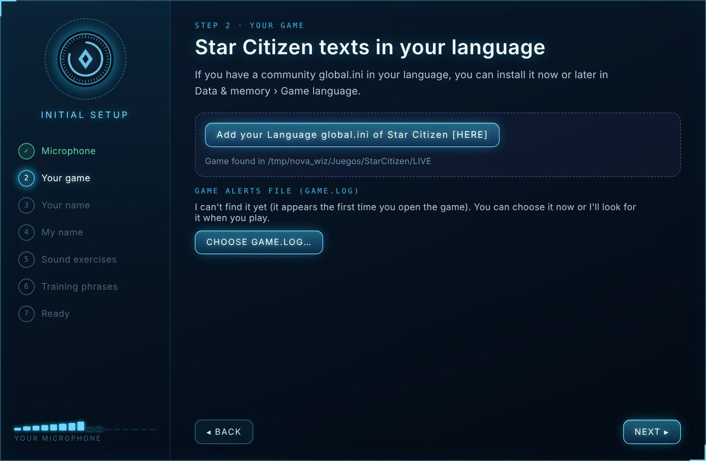</p>

## AI engines and keys

NOVA AI uses free services in an **engine chain**: if one runs out of quota, she moves to the next.

| # | Provider | Model |
|---|---|---|
| 1 | Google Gemini | `gemini-flash-lite-latest` |
| 2 | Google Gemini | `gemini-3.5-flash-lite` |
| 3 | Groq | `openai/gpt-oss-120b` |
| 4 | OpenRouter | `openrouter/free` |

*Mistral* (paid since August 2026) and *DeepSeek* are optional: they join the chain only if you add your own key.

The installer in *Releases* **comes without AI keys**: Nova obeys voice commands from the first minute, and to talk and search she needs at least one free key. You get one in 2 minutes with no credit card (Gemini and Groq are recommended): chapter 11 of the manual, *Your own API keys*, explains it step by step. Then paste them in ***Nova › Intelligence › Free keys***. Nova always answers in the language you chose.

**About keys in this repository:** the program supports **encrypted** factory keys (`recursos/claves_iniciales.enc`, see [`core/keyvault.py`](core/keyvault.py)), but the master key is **not in the repository or in the public release**, so those keys can't be used or read. If you build your own version, use your own keys with [`build/cifrar_claves.py`](build/cifrar_claves.py), or leave them out and each user will add theirs.

**Anonymous questionnaire service:** the questionnaire is sent to a small Cloudflare Worker that holds the GitHub token and creates the issue, so the program carries no token. Its code and deployment steps are in [`servicios/cuestionario`](servicios/cuestionario). If you build your own version, set your own service address in `core/survey.py` or leave it empty to hide the questionnaire.

## Feedback, bugs and ideas

Tried it? Tell us in **[Issues](../../issues)**: what you liked, what fails and what you miss. For a bug it helps a lot to include your language, Windows version, what you said to Nova and the `nova.log` file (*Settings › General › Files › Log*). Feedback is welcome in any of the five languages.

## Run from source

```bat
git clone https://github.com/0zzyt0/NOVA-AI.git
cd NOVA-AI
INSTALAR_CONSOLA.bat   :: creates the .venv environment and installs what's needed (portable mode)
INICIAR.bat
```

Requirements: Windows 10/11 and Python 3.11–3.13. To see technical messages, use `DEPURAR.bat`.

## Build the installer

The executables (`NOVA AI Setup.exe`, `NOVA AI.exe`, `Desinstalar NOVA AI.exe`) are small Go programs that use only the standard library. The icon, manifest and version information are generated with [`build/winres.py`](build/winres.py), with no external tools.

```bash
build/build_win.sh                    # everything at once (Go 1.24+ and Python 3); output goes to dist/
NOVA_STAGE=exes build/build_win.sh    # 1st: only the program .exe files and the small installer
NOVA_STAGE=pack build/build_win.sh    # 2nd: packs those (already signed) .exe files into the all-in-one installer
```

Public releases are built with **GitHub Actions** ([`.github/workflows/compilar.yml`](.github/workflows/compilar.yml), "Compilar y firmar") on GitHub's servers, when a `v*` tag is pushed or by hand. The workflow:

1. builds the .exe files and sends them for signing;
2. packs the installer and sends it for signing;
3. publishes the `Setup.exe`, the portable `.zip` and `SHA256SUMS.txt` as an artifact.

Signing only runs once SignPath is configured for the project; without it, the workflow produces the same release unsigned. More details in [`build/LEEME_COMPILAR.md`](build/LEEME_COMPILAR.md) (Spanish).

## Project structure

| Folder | Contents |
|---|---|
| `nova.py` | Start-up: initial language, fresh data, listening, voice and the window |
| `core/` | Speech recognition and synthesis, AI, commands and keys, Game.log reading, holograms, overlay, logbook, memory, data sources, translation and languages (`i18n.py`, `lang_data.py`, `manual_tr.py`) |
| `gui/` | Local window (HTML + JS) and server; `gui/web/manual/` is the manual and `gui/web/acerca/` the About window |
| `instalador/` | Graphical installer and uninstaller in five languages (PowerShell + WPF) |
| `build/` | Sources of the .exe files (Go), Windows resource generator and icons |
| `.github/workflows/` | Build and signing with GitHub Actions |
| `servicios/cuestionario/` | Cloudflare Worker for the anonymous questionnaire (creates the issue without putting a token in the program) |
| `recursos/idiomas/` | Window and Nova texts in English, Catalan, French and German |
| `datos/comandos.json` | Factory voice commands (Spanish), plus `datos/comandos.<language>.json` with their phrases in each language |
| `NORMAS_Y_PRIVACIDAD*.md` | Terms of use and Privacy policy in the five languages |

## Privacy

Your data stays on your PC (`%LOCALAPPDATA%\NOVA AI\datos`). There are no servers of our own, no accounts, no telemetry and no recordings. What you ask Nova is sent as text to the AI service that answers it, just as if you typed it on its website. Texts that aren't already translated are translated with Google Translate. Full details in the [Terms of use and Privacy policy](NORMAS_Y_PRIVACIDAD.en.md).

## About

<p align="center">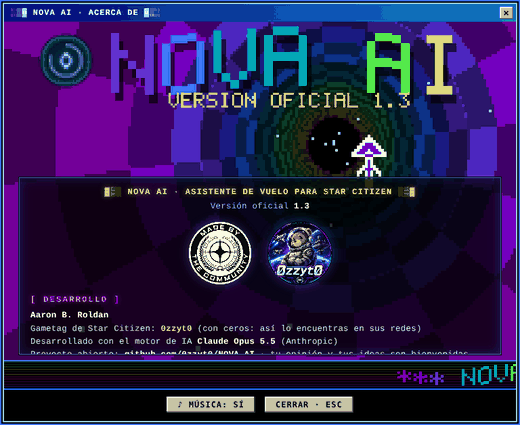</p>

**NOVA AI · Official version 2.0**, by **Aaron B. Roldan** (Star Citizen gametag: **0zzyt0**). Built with the **Claude Opus 5.5** AI engine (Anthropic).

**Thanks** to the **Defcorp org**, and to Faibo, Galleg0, Sr.Scott, AlpacaInTrouble, Lother… and many more!

## License

NOVA AI is **free software under the [MIT License](LICENSE)**: you can use, modify and share it, including inside other projects, as long as you keep the copyright notice and the license. Spanish summary and third-party rights in [LICENCIA.txt](LICENCIA.txt).

## Code signing policy

Free code signing provided by [SignPath.io](https://about.signpath.io), certificate by [SignPath Foundation](https://signpath.org).

The Windows executables (`NOVA AI Setup.exe`, `NOVA AI.exe` and `Desinstalar NOVA AI.exe`) are built from this repository with GitHub Actions and are signed only after the approver reviews and authorises each release.

**Team roles**

- Committers and reviewers: [Aaron B. Roldan (@0zzyt0)](https://github.com/0zzyt0)
- Approvers: [Aaron B. Roldan (@0zzyt0)](https://github.com/0zzyt0)

**Privacy policy**

This program will not transfer any information to other networked systems unless specifically requested by the user or the person installing or operating it. What each online feature sends, and how to turn it off, is described in the privacy policy shown during installation: [English](NORMAS_Y_PRIVACIDAD.en.md) · [Español](NORMAS_Y_PRIVACIDAD.md) · [Català](NORMAS_Y_PRIVACIDAD.ca.md) · [Français](NORMAS_Y_PRIVACIDAD.fr.md) · [Deutsch](NORMAS_Y_PRIVACIDAD.de.md).

## Third-party rights

Star Citizen®, Squadron 42®, Roberts Space Industries® and Cloud Imperium® are registered trademarks of Cloud Imperium Rights LLC. All references to Star Citizen that appear in NOVA AI (logos, ship names, characters, items, places and other game content) belong to their rightful owners and are subject to their own terms of use. NOVA AI is an independent, non-profit fan project: it is not affiliated with, sponsored or endorsed by Cloud Imperium Games.

The lookup pages [scmdb.net](https://scmdb.net), [UEX Corp](https://uexcorp.space), [Star Citizen Wiki](https://starcitizen.tools), [VerseGuide](https://verseguide.com), StarMap, SPViewer, [Universal Item Finder (CStone)](https://finder.cstone.space) and SC Haulers, as well as the [Roberts Space Industries](https://robertsspaceindustries.com) website, belong to their respective authors, have their own terms of use, and their content is protected. NOVA AI only **looks them up online and reads the information they publish**, just as anyone would from a browser: it **does not modify, alter or tamper with their data, does not redistribute it** (scmdb.net data, licensed CC BY-NC-ND 4.0, is not included in this repository: it is downloaded on each computer) **and does not claim authorship of it**. The same applies to Google Translate, the community translation `global.ini` files and the 0zzyt0 Spanish translation.

<p align="center"><b>o7 · See you in the 'verse</b></p>
